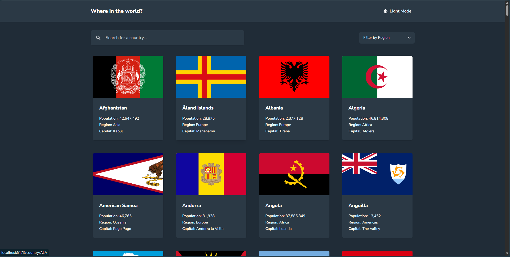

# Frontend Mentor - REST Countries with color theme switcher

A country browser built for the Frontend Mentor REST Countries challenge.

## Overview

### Features

- Browse countries
- Search by country name
- Filter by region
- Open a country detail page
- Navigate to bordering countries
- Switch between light and dark themes

### Screenshot

### Links

- Live Site: [[Rest Countries](https://countries-frontend-mentor.vercel.app/)]
- Frontend Mentor solution: [Add your solution URL]

## Built with

- React
- TypeScript
- React Router
- Tailwind CSS
- Vite

## What I learned

I practiced describing the country data with TypeScript, separating lookup and filtering logic from React components, and combining search and region filters. I also worked with client-side routing, theme persistence, and responsive layouts.

## Continued development

I want to keep improving keyboard accessibility, test the interface at narrow viewport widths, and explore putting the search and region filters in the URL.

## AI collaboration

I used ClaudeAI to discuss milestone requirements, review TypeScript errors, and get explanations and example code. I made the implementation decisions and should describe here what I adapted, verified, or changed while building the project.

## Author

- Frontend Mentor: [@LaDonaAmor](https://www.frontendmentor.io/profile/LaDonaAmor)
